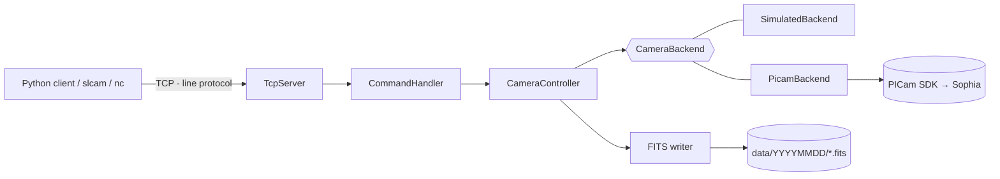

# SuperLOTIS Camera Control

[](https://github.com/jacobvider/superlotis-camera/actions/workflows/ci.yml)


Network control software for the **Teledyne Princeton Instruments Sophia 2048B-UV**,
the NUV-optimized CCD camera on the SuperLOTIS robotic telescope.

* **`slcamd`**: a C++17 daemon that runs on the camera PC, drives the camera
  through the PICam SDK, and writes standards-compliant FITS files.
* **`superlotis`**: a typed, dependency-free Python client library and `slcam`
  command-line tool for the scheduler and observers.

Everything builds and is tested without the camera or the SDK, using a
physically plausible simulated backend.

```console
$ slcamd --backend simulated --data-dir ./data &
$ slcam exptime 30
30.0
$ slcam expose --object GRB261105A
./data/20261105/superlotis_20261105T041502_object_0001.fits
```

```python
from superlotis import CameraClient

with CameraClient("camera-pc", token="...") as cam:
    cam.set_gain("medium")
    cam.set_setpoint(-60)
    files = cam.burst(5, exptime=30, object="M31")
```

---

## Features

* **Correct exposures**: exposure time and shutter mode are passed with every acquisition.
  Darks are always taken with the shutter closed, and biases are always 0 s.
* **Standard FITS output**: unsigned 16-bit (`BITPIX=16`, `BZERO=32768`) files with a
  complete header (`DATE-OBS`, `EXPTIME` in seconds, `IMAGETYP`, `CCD-TEMP`, `GAINMODE`, ...).
  Files are written atomically (temp file, then `fsync`, then `link`) and are never overwritten.
* **Responsive while exposing**: multi-client TCP server. Any client can poll `status`
  (state, progress, temperature) during another client's 4-minute exposure.
* **Machine-readable protocol**: `OK …` / `ERR <code> …` replies with stable error codes,
  still usable by hand with `nc`. See [docs/protocol.md](docs/protocol.md).
* **Safe defaults**: binds to loopback, optional token authentication, client and line
  limits, idle timeouts, remote shutdown off. It never falls back silently to a demo camera.
* **Strict configuration**: INI file plus CLI overrides. Unknown keys and out-of-range
  values are rejected at startup with `file:line` errors (`slcamd --check-config`).
* **Production deployment**: systemd unit with hardening, graceful SIGTERM handling
  (in-progress exposures finish and are saved), structured logs to journald.
* **Tested at every layer**: 60 C++ tests (unit + real-socket end-to-end), 55 Python
  tests, and a contract suite that runs the Python client against both an in-memory
  fake and the real server. CI runs gcc + clang with `-Werror`, ASan/UBSan, TSan,
  clang-format, ruff, mypy `--strict`, and Python 3.9–3.13.

## Architecture



Hardware access is behind a five-method interface, so the controller, protocol
and server are tested against a test double. The concurrency model uses a
hardware mutex, a state mutex, and an atomic busy flag. It is verified under
ThreadSanitizer. Details: [docs/architecture.md](docs/architecture.md).

## Quick start (no camera needed)

Requirements: CMake ≥ 3.16, a C++17 compiler, Python ≥ 3.9.

```bash
# Server
cmake -S . -B build -DCMAKE_BUILD_TYPE=Release
cmake --build build -j
(cd build && ctest --output-on-failure)

build/server/slcamd --data-dir ./data            # simulated camera on localhost:6972

# Client (in another terminal)
pip install -e "python[dev]"
slcam status
slcam setpoint -70
slcam expose -t 5 -o M31
slcam --json status
```

Or drive it with nothing but netcat:

```bash
printf 'exptime 2\nexpose object=test\nquit\n' | nc localhost 6972
```

To build against real hardware, see [docs/deployment.md](docs/deployment.md)
(`-DSUPERLOTIS_WITH_PICAM=ON`, systemd setup, network hardening).

## Repository layout

```
server/
  include/superlotis/   public headers (backend interface, controller, protocol, FITS, config)
  src/                  implementation + slcamd main
  tests/                GoogleTest suite and SpyBackend test double
python/
  src/superlotis/       client, CLI, typed models, errors, FakeCameraServer
  tests/                pytest suite (fake + real-server contract tests, astropy FITS checks)
config/                 annotated example configuration
deploy/systemd/         service unit
docs/                   protocol spec, architecture, deployment, migration guide
```

## Development

```bash
make            # configure + build + C++ tests
make test       # C++ and Python tests (including against the real server)
make lint       # clang-format, ruff, mypy
make sanitize   # ASan + UBSan build and tests
```

See [CONTRIBUTING.md](CONTRIBUTING.md).

## Background

This is a ground-up rewrite of a prototype camera server written for
SuperLOTIS. A code review of the prototype found defects that would
have silently corrupted science data. Each one now has a regression test:

| Prototype behaviour | Fixed |
|---|---|
| `expose`/`dark` ignored the configured exposure time (hard-coded 6 s) | Exposure time is passed with every acquisition |
| `dark` didn't close the shutter; `bias` took a 100 ms exposure | Shutter forced closed for darks and biases; biases are 0 s |
| Gain setter wrote back the current gain; gain/exptime getters returned uninitialized memory | Setters verify by reading the value back |
| Temperature could only be set when already at the set point | Set point can always be changed |
| FITS written as signed 16-bit: pixels > 32767 ADU overflowed | `BITPIX=16` + `BZERO=32768` (standard unsigned) |
| `EXPTIME` in ms; `DATE-OBS` = file-conversion time | Seconds; exposure start time |
| Every frame overwrote the same file | Unique dated filenames, atomic no-overwrite writes |
| Fell back to the SDK demo camera if hardware was missing | Demo mode is opt-in and recorded in every header |
| Single-threaded; `status` could not run during an exposure | Per-client threads; non-blocking `status` |
| Listened on all interfaces with no auth; network input passed to `printf` as a format string | Loopback default, token auth, strict parsing |
| Build hard-coded paths from one machine and mismatched CFITSIO header/library versions | CMake, no FITS library dependency |

The full list is in [CHANGELOG.md](CHANGELOG.md), and the command mapping is in
[docs/migration.md](docs/migration.md).

## Status

The simulated backend, protocol, server, FITS writer and Python client are
complete and tested. The PICam backend was written against the PICam 5.x
Programmer's Manual and compile-checked against those API signatures, but
**it has not yet been run on the camera**. Validating it on hardware is the next
milestone (see `docs/deployment.md` §4 for the demo-camera procedure).

Roadmap: hardware validation; exposure abort (`Picam_StartAcquisition` /
`Picam_StopAcquisition`); ROI and binning; a `status` push/subscribe mode for
the scheduler.

## License and acknowledgements

MIT. See [LICENSE](LICENSE).

The original prototype was developed in the Hamden Lab (University of
Arizona) for SuperLOTIS. PICam is a product of Teledyne
Princeton Instruments; its SDK is not included or redistributed here.
