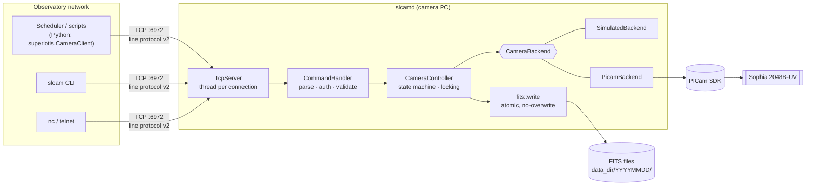

# Architecture

## Layers

| Layer | File | Responsibility |
|---|---|---|
| Transport | `tcp_server.cpp` | Accept loop (`poll` + self-pipe for shutdown), one thread per client, line framing, max line length, idle timeout, client limit. Knows nothing about cameras. |
| Protocol | `protocol.cpp` | Parses request lines, enforces authentication, validates arguments, maps exceptions to `ERR <code>` replies. Pure logic, unit-tested without sockets. |
| Domain | `controller.cpp` | Owns exposure settings and state (`idle → exposing → writing → idle`). Decides exposure time and shutter for each frame type, builds the FITS header, names files. |
| Hardware | `camera_backend.hpp` | A five-method interface (`info`, gain get/set, set point, `temperature`, `acquire`). `SimulatedBackend` and `PicamBackend` implement it. |
| Storage | `fits_writer.cpp` | Dependency-free FITS writer: 2880-byte blocks, `BITPIX=16` + `BZERO=32768` for unsigned data, write to `*.part`, `fsync`, then `link()` into place (fails rather than overwriting). |

## Key design decisions

**Exposure settings travel with every acquisition.** `CameraBackend::acquire(exposure_s, shutter)`
takes both values explicitly, so a frame can't silently use stale settings
(the original `expose()` ignored `exptime`). The controller forces the shutter
closed for darks and biases, and forces biases to 0 s.

**Two locks, one atomic.** `hw_mutex_` serializes every backend call.
`state_mutex_` guards the small status struct. The `busy_` atomic is claimed
with compare-and-swap by an exposure. `status()` only *try-locks* the
hardware, so it returns a cached temperature during an exposure and never
blocks behind it. All of this runs under ThreadSanitizer in CI.

**No silent fallbacks.** The original code opened the PICam *demo* camera if
no hardware was found, so a night could be "observed" on synthetic data. Now
the demo camera is only used with `--demo`, every frame records
`SIMULATE = T/F` in its header, and the server refuses to start if the camera
can't be opened.

**Write the FITS file directly.** The original pipeline wrote a raw dump
(two frames' worth), "resized" it (the result was never saved), and converted
it to FITS with a signed-16-bit type that overflowed above 32767 ADU. The new
writer emits standard unsigned FITS in one step. Files are verified with
astropy in the integration tests.

**Fail fast on configuration.** Unknown config keys, out-of-range values and
inconsistent limits are startup errors with file:line locations.
`slcamd --check-config` runs as `ExecStartPre` in the systemd unit.

**Safe network defaults.** The server binds to loopback unless told otherwise.
It supports a shared-secret token (compared in constant time), caps the number
of clients, times out idle connections, and only allows remote `shutdown`
when explicitly enabled.

## Testing strategy

| Level | Tooling | What it covers |
|---|---|---|
| C++ unit | GoogleTest + `SpyBackend` test double | Controller rules (one regression test per original defect), FITS encoding byte by byte, config parsing, protocol parsing/encoding, simulator physics |
| C++ end-to-end | GoogleTest over real sockets | Pipelining, half-close, overlong lines, client limit, auth per connection, `status` while another client exposes, remote shutdown |
| Python unit | pytest + `superlotis.testing.FakeCameraServer` | Client, CLI, error mapping |
| Contract | the same pytest suite pointed at the real `slcamd` | Keeps the Python client, the fake server and the C++ server in agreement |
| Data | astropy | Written files are valid FITS with the expected dtype, shape and header |
| Static/dynamic analysis | `-Wall -Wextra -Wconversion -Werror` (gcc + clang), ASan, UBSan, TSan, clang-format, ruff, mypy `--strict` | |
